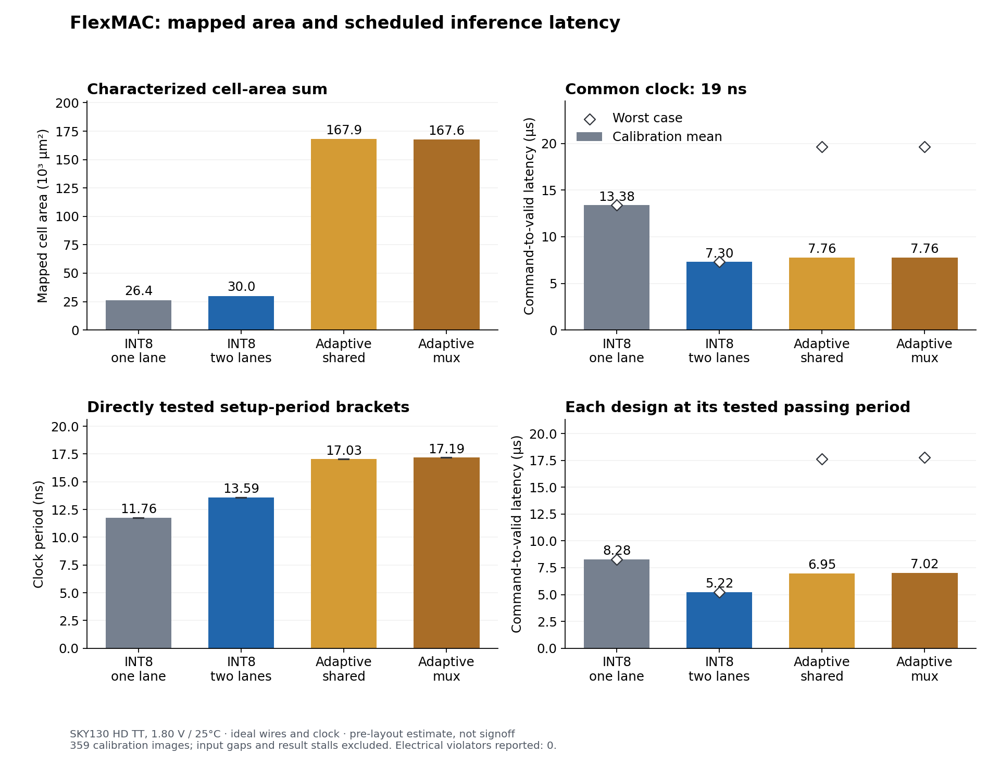

# FlexMAC

**Precision-configurable arithmetic for quantized AI inference.**

FlexMAC investigates when INT4 computation is useful compared with INT8 for a
small classifier: does it meet an accuracy budget, and what area/latency cost
comes with supporting both modes? The contribution is the verified implementation
and evaluation; configurable precision itself is an established technique.

[Download the IEEE-style technical report](output/pdf/flexmac_technical_report.pdf),
[edit the LaTeX source](docs/report/latex/main.tex), or
[download the Overleaf-ready source ZIP](output/flexmac_latex_source.zip).

## Main finding

For this frozen linear classifier, ordinary two-lane INT8 is a stronger design
than the implemented adaptive INT4/INT8 engine. The adaptive design preserves
INT8 decisions, but its certification hardware costs more area and its fallback
adds latency. The project records that result, including the failed hypotheses.

| Raw-input engine | Mapped cell area (µm²) | Mean latency, common 19 ns clock | Mean latency, own tested setup period |
| --- | ---: | ---: | ---: |
| Single-lane INT8 | 26,358 | 13.38 µs | 8.28 µs |
| Two-lane INT8 | 30,006 | 7.30 µs | 5.22 µs |
| Adaptive shared | 167,946 | 7.76 µs | 6.95 µs |
| Adaptive mux | 167,562 | 7.76 µs | 7.02 µs |

These are pre-layout SKY130 HD typical-corner estimates with ideal wires/clock,
not fabricated-chip measurements. Mean latency uses 359 calibration images and
excludes injected input gaps. The 10 ns mapping target failed for all designs;
the table uses directly tested passing periods. No power saving is claimed.
See the [mapped comparison and verification scope](docs/mapped_study.md).



The [score-comparison pipeline follow-up](docs/score_pipeline.md) improves the
two-lane INT8 engine further. Separating score calculation from class comparison
reduces latency from **5.220 to 4.448 µs (14.8%)** at each design's directly tested
passing period, for about **1.5% more cell area**. It adds ten cycles per image;
at a common 15 ns clock the original baseline is faster. Full 359-image mapped
replay passes in both two-state and four-state simulators for both designs.

The [illustrated architecture guide](docs/architecture.md) explains the
before/after datapath, controller states, arithmetic widths and the 384-to-394
cycle schedule, with PNG drawings, SVG exports and editable Mermaid diagrams.

## Current implementation

- A shared partial-product core: one signed INT8 product, or two signed INT4
  products summed per beat.
- Fixed INT8 and dual-INT4 reference cores, plus a separate-unit mux baseline.
- A streaming 32-bit dot-product accumulator with captured precision mode,
  input-valid gating, output backpressure, and reset cancellation.
- An independent Python arithmetic model, exhaustive product vectors, framed
  tests including signed overflow, and a deliberately rejected sign-bug control.
- A ten-class, 64-feature digit classifier: feature storage, frozen weight ROM,
  bias addition, accumulation and signed argmax in Verilog, in both precisions.
- Verilog classifier tests against frozen held-out scores, with reset/stall tests
  and a deliberately rejected unsigned-argmax control.

The [arithmetic specification](docs/specification.md) defines every width,
signed interpretation, handshake, and wrap behavior. The shared and mux engines
must return identical results for identical frames.

**Status:** the [first RTL verification run](https://github.com/jrmywm/FlexMAC/actions/runs/40445230045)
passed 131,072 product vectors, 172 frames per stream implementation, reset and
overflow checks, a rejected sign-bug control, and six generic synthesis checks.
The first generic result does **not** favor sharing: 732 cells for the shared
product versus 650 for the separate-unit mux. See the [initial results](docs/initial_results.md).
The frozen classifier model gives 345/360 correct in float and INT8, and 341/360
in INT4. The INT4 drop of 1.11 percentage points **misses** the one-point budget.
Both RTL implementations reproduced all 14,400 checked class scores in
[passing CI](https://github.com/jrmywm/FlexMAC/actions/runs/40447266654).
Without input gaps, INT8 takes 704 cycles per image and INT4 takes 352.
The current shared classifier uses 3,958 generic cells versus 3,854 for the mux
baseline, so sharing does not show a logic-count benefit here either.
See the [verified classifier results](docs/classifier_results.md) and
[classifier contract and methodology](docs/classifier.md).
Those historical generic counts do not establish physical area, timing or power.
The later raw-input mapped study above provides area and timing estimates;
power remains unmeasured.

## Precision-fallback investigation

Complete fixed-INT8 and fixed-INT4 classifier baselines and a standalone
conservative INT4/INT8 agreement checker passed CI. The frozen
training/calibration study finds a real limitation:
the compact checker accepts only 134/359 calibration inputs, so serial fallback
would be slower than always-INT8. Tighter input-dependent bounds accept 351/359
offline, and the adaptive RTL reproduces this result: 351 certified inputs,
eight INT8 reruns, and agreement with INT8 on all 359 calibration images.
Mean latency without input gaps is 408.26 cycles versus 704 for the matched
always-INT8 raw-input baseline. **The cost is about 9.4x the generic logic.**
The worst-case path takes 1,034 cycles. The later mapped comparison finds that
two-lane INT8 is smaller and faster than this prototype. See the historical
[verified precision results](docs/precision_results.md).
See [the agreement derivation and feasibility study](docs/agreement_study.md).
The [adaptive hardware contract](docs/adaptive.md) explains input preservation,
on-chip preprocessing, certification and fallback.

A [two-lane INT8 baseline](docs/two_lane_int8.md) has now been implemented to
test ordinary parallelism against the adaptive engine. It passed all class-score
and decision checks on the same 359 calibration images at **384 cycles per
image and 3,492 generic cells**. In that run, adaptive shared uses 26,855 cells
and averages 408.26 cycles. Its second weight read and additional arithmetic are
counted. Ordinary parallel INT8 is the stronger baseline on both cycle count
and generic logic here. The mapped study confirms its area and latency advantage
under the stated library and timing assumptions.

## Run the checks

The [library-mapped study](docs/mapped_study.md) now has a pinned SKY130/OpenSTA
flow, direct setup-period searches, common-clock checks and mapped functional
replay. Full compiled two-state replay covers 359 images per design. Separate
four-state simulation covers all 359 images per INT8 baseline and 18 selected
images per adaptive design, including every calibration fallback. Generic counts
remain distinct from standard-cell area and timing. See the report for evidence
and the limits of the replay coverage.

Python 3.10+ is sufficient for the independent model:

```text
python -m unittest discover -s tests -v
```

With Icarus Verilog (`iverilog`, `vvp`) and Yosys on PATH:

```text
python scripts/check_rtl.py
python scripts/check_synthesis.py
bash scripts/check_classifier.sh
bash scripts/check_agreement.sh
bash scripts/check_adaptive.sh
bash scripts/check_scorepipe.sh
```

The RTL script generates 65,536 operand pairs per mode, tests both stream
implementations against the oracle, and requires a temporary INT4 sign bug to
fail its decision check. Stream tests include real 32-bit overflow in both
directions. A missing tool produces BLOCKED, not a passing RTL result.
`--generate-only` generates vectors without running simulation.

CI runs on Ubuntu with lightweight open-source tools. Reports, source hashes,
logs and a credential-free source bundle are uploaded as `flexmac-verification`.
Build outputs are ignored under `build/`. No FPGA vendor suite is required.

## What we will measure

| Question | Required evidence |
| --- | --- |
| Is the integer arithmetic correct? | Exhaustive products and oracle-checked streamed sums |
| Does INT4 preserve enough accuracy? | Frozen quantization and a held-out classifier test set |
| Is useful work faster? | Measured frame cycles and feasible timing, including delivery/control overhead |
| Can adaptive precision preserve INT8 decisions? | Exact agreement bounds, RTL calibration replay and full checker cost |
| Does adaptation beat ordinary parallel INT8? | Complete two-lane baseline, identical inputs and same-run cost/cycle comparison |
| Does sharing save area? | Same-library mapping against fixed and duplicated-unit baselines |

The accuracy target is at most one percentage point below the floating-point
reference on the same test set. INT8 meets it; the frozen INT4 model misses it.
The [milestone plan](docs/research_plan.md) fixes the methodology and scope;
milestones can finish sooner than the original one-week estimate.

## Scope

This is a small linear-inference RTL project. The original classifier accepts
host-quantized features. The adaptive engine accepts raw pixels and implements
quantization, certification and INT8 fallback in Verilog. Training and frozen
model preparation remain offline. It has not demonstrated a fabricated chip,
FPGA execution, or measured energy savings. INT4 arithmetic sums two lanes into
one dot-product term. The adaptive controller selects precision internally;
the original interface accepts an external mode. Established work such
as [Bit Fusion](https://arxiv.org/abs/1712.01507) motivates the comparison.
