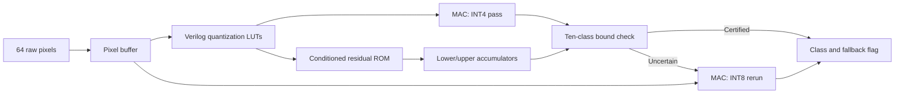

# Input-conditioned adaptive classifier

`rtl/flexmac_adaptive.v` implements the promising conditioned-bound candidate
from [the feasibility study](agreement_study.md). Verification and synthesis are
pending the next CI run. The compact pairwise checker remains a separate,
lower-cost candidate; it is not used by this adaptive engine.

## Algorithm and certificate

The engine accepts 64 raw 5-bit pixels, each in [0,16], and retains them in a
320-bit bank. Two small combinational LUTs implement the frozen INT8 and INT4
preprocessing exactly, including rounding ties to even. Keeping the raw input
allows an INT8 rerun without host retransmission or reconstructing lost bits.

For each class c and feature i, define the integer residual
`r(c,i,p) = x8(p)*w8[c,i] - 366*x4(p)*w4[c,i]`.
For an observed INT4 value v, the frozen residual ROM stores the minimum and
maximum r over ALL raw p in [0,16] with `x4(p)=v`. Every INT4 bin has at least
one raw preimage. Entries are signed 13 bits, as verified by export and unit tests.
The class offset is `b8[c]-366*b4[c]`.

During the 320-cycle INT4 pass, two residual lookups per cycle accumulate the
lower and upper residual sums alongside the existing MAC. At the end of each
class:

```
lower[c] = 366*S4[c] + bias_offset[c] + sum_i residual_min(c,i,x4(pixel[i]))
upper[c] = 366*S4[c] + bias_offset[c] + sum_i residual_max(c,i,x4(pixel[i]))
lower[c] <= S8[c] <= upper[c]
```

The INT4 winner c is accepted only if `lower[c] > upper[j]` for every j != c.
This implies strict superiority of the INT8 score and therefore identical INT8
classification. If any comparison fails, the same core runs all ten INT8 dot
products from the buffered raw pixels. The output is a class, fallback flag and
input-error flag; it does not expose an approximate score as an exact INT8 score.

The certificate is a separable bound over the full supported pixel domain, not
a margin threshold fitted to prediction labels. Hardware faults, unsupported
model changes and inputs outside this domain are outside that derivation.

## Interface and cycle contract

The start, input and result interfaces use ready/valid handshakes on rising
edges. There is no overlap between transactions. Reset is synchronous active
high and cancels loading, either computation pass, checking and pending output.
Outputs are masked during reset and while result-valid is false. Buffered
pixels and interval arrays are not reset; a complete new frame and all ten
class intervals must be written before they can be consumed.

An accepted pixel >16 sets an error flag. After all 64 accepted pixels the
engine returns an error with class=0 and fallback=0, without running inference.
Invalid pixels presented with pixel-valid=0 are ignored. The output remains
stable until consumed; input and command ready remain low during computation
and output backpressure.

Expected command-acceptance to result-valid, with no input gaps:

| Path | Load | INT4 | Check | INT8 | Total cycles |
| --- | ---: | ---: | ---: | ---: | ---: |
| Certified INT4 decision | 64 | 320 | 10 | 0 | 394 |
| INT8 fallback | 64 | 320 | 10 | 640 | 1,034 |
| Always-INT8 raw-input baseline | 64 | 0 | 0 | 640 | 704 |
| Invalid frame | 64 | 0 | 0 | 0 | 64 |

These are implementation contracts until confirmed by simulation. Input gaps
add cycles; output-consumption stalls occur after result-valid and are excluded.
Elapsed time and energy require physical timing and power evidence.

## Fair baseline and hardware cost

`FORCE_INT8=1` builds an always-INT8 version with the same raw-pixel input,
range checks, buffering, handshake and class-only result. Its generate branch
instantiates the fixed INT8 product and omits the residual ROM. Unused adaptive
control/storage is eligible for synthesis removal. `PRODUCT_IMPL=0` selects the
shared configurable product for the adaptive engine; 1 selects the mux baseline.

The residual ROM has 9,600 input combinations with two 13-bit values each:
249,600 logical data bits before logic synthesis. The design reads two entries
per INT4 cycle and also has residual accumulators, ten lower/upper interval
register pairs, constant score scaling and a ten-cycle checker. The lookup table
is an initial implementation, not a claim of minimal cost. These resources can
outweigh the saved average cycles. Report both full-engine cost and latency;
do not treat the certificate as free or equate logical ROM bits with silicon area.

## Validation boundary

The adaptive bench uses only the 359 calibration images, with precomputed
INT8/INT4 score references from the unchanged frozen models. It checks every
computed class score, each RTL interval's containment of the INT8 score,
accept/fallback decisions, equality to the INT8 class, exact cycle counts,
stalls, invalid pixels and reset cancellation across the processing phases.
Both configurable product implementations and the always-INT8 raw baseline are
tested. No adaptive test-set accuracy has been evaluated, and calibration
results must not be presented as fresh held-out generalization evidence.

```bash
bash scripts/check_adaptive.sh
```

Normal RTL replay uses frozen files and needs no training libraries. The
optional offline exporter and exact-bound construction remain Python tools;
preprocessing, MACs, residual accumulation, certification, rerun control and
class selection in this engine are Verilog.



This is a conceptual RTL block diagram. The two MAC nodes are processing phases
of the selected product implementation, not independently operating engines.
