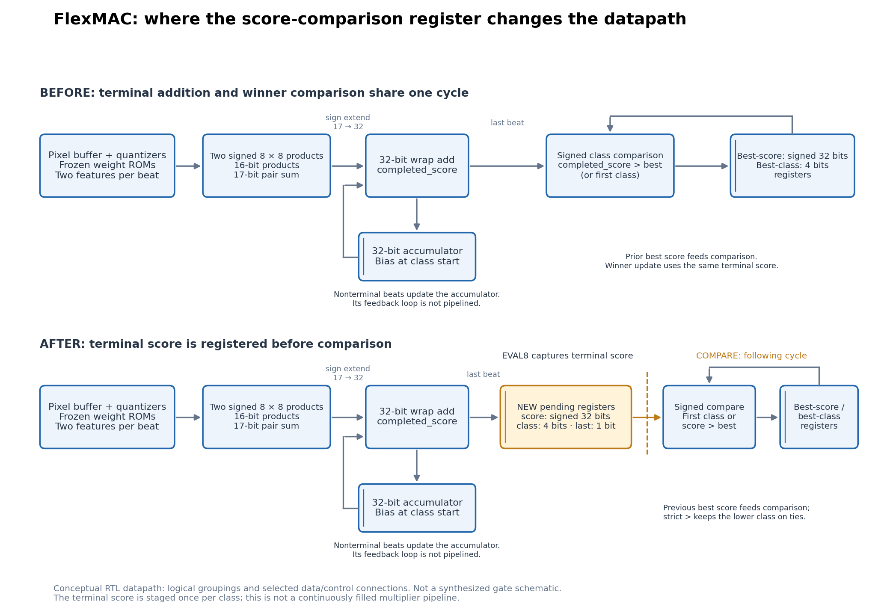
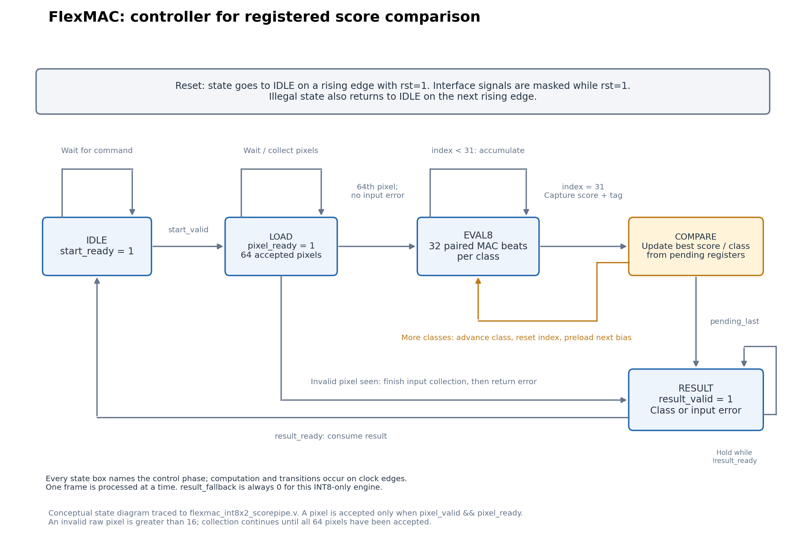
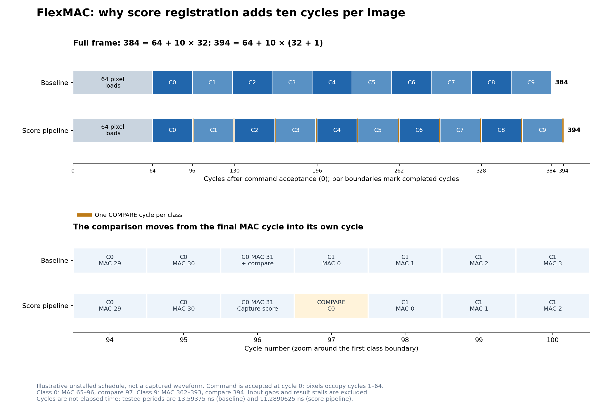
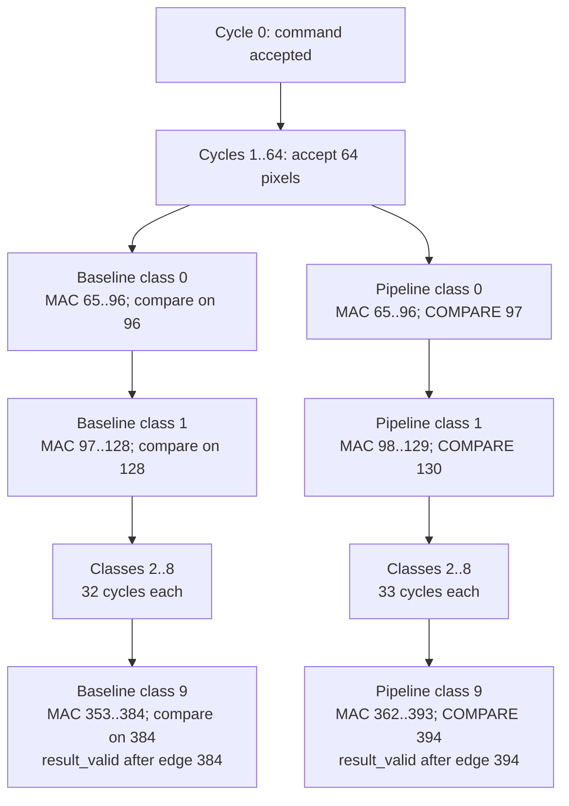

# Registered score-comparison architecture

This page explains the existing two-lane INT8 score-pipeline experiment. The baseline is [`flexmac_adaptive`](../rtl/flexmac_adaptive.v) with `FORCE_INT8=1` and `INT8_LANES=2`; the new engine is [`flexmac_int8x2_scorepipe`](../rtl/flexmac_int8x2_scorepipe.v). Both load the same 64 raw pixels and evaluate ten classes using two signed INT8 products per cycle. The new engine registers each completed class score before comparing it with the current winner.

All diagrams here are **conceptual RTL diagrams**, not gate schematics or captured waveforms. The PNG figures provide a static view; each accompanying Mermaid block provides editable diagram source. Measurement evidence and limitations are in the [score-pipeline report](score_pipeline.md).

## Before and after: move comparison across a register boundary

For a class, the accumulator starts with its signed 32-bit bias. Beat `i` selects pixels `2i` and `2i+1`, quantizes both, reads their class weights, and adds the two products to the accumulator. There are 32 beats per class.

The baseline compares `completed_score` directly with `best_score` on the terminal beat. The new engine captures `completed_score` into `pending_score` on that beat, then compares it in a separate `COMPARE` cycle. It captures `pending_class` and `pending_last` alongside the score so that the comparison retains its class identity and knows when to publish the final result. No register is inserted into the accumulator feedback loop, so each `EVAL8` cycle still processes one pair.

[SVG version](figures/scorepipe_datapath.svg)

```mermaid
flowchart TB
    subgraph Before["Before: two-lane INT8 baseline"]
        B0["64 x 5-bit pixel registers<br/>pair select + quantizers + weight ROMs"] --> B1["Two signed 8 x 8 multipliers<br/>16-bit products -> signed 17-bit pair sum"]
        B1 --> B2["Sign extend to 32 bits<br/>+ accumulator -> completed_score"]
        BA["accumulator register<br/>signed 32 bits; bias preload"] --> B2
        B2 -->|"beats 0..30: feedback"| BA
        B2 -->|"beat 31: same-cycle path"| B3["Signed comparison + winner mux"]
        BB["best_score / best_class registers"] --> B3
        B3 --> BB
    end
    subgraph After["After: registered score comparison"]
        A0["Same pixel storage, quantization<br/>weight reads and paired products"] --> A1["Sign extend pair sum to 32 bits<br/>+ accumulator -> completed_score"]
        AA["accumulator register<br/>signed 32 bits; bias preload"] --> A1
        A1 -->|"beats 0..30: feedback"| AA
        A1 -->|"beat 31: capture"| AP["NEW register boundary<br/>pending_score: signed 32<br/>pending_class: 4; pending_last: 1"]
        AP -->|"next cycle: COMPARE"| AC["Signed comparison + winner mux"]
        AB["best_score / best_class registers"] --> AC
        AC --> AB
    end
```

The arithmetic widths preserve the existing score contract:

| Quantity | Width and interpretation |
| --- | --- |
| Raw pixel | Unsigned 5 bits; only 0 through 16 are accepted as valid values |
| Quantized pixel and weight | 8-bit bit patterns interpreted as signed INT8 in the multiplier; valid pixels map from -127 through +127 |
| Each product / pair sum | Signed 16 bits / signed 17 bits; the extra sum bit also represents two products of `(-128)*(-128)` |
| Bias, accumulator, completed/pending/best score | Signed 32 bits; sign-extended pair sum is added modulo `2^32`, with no saturation |
| Class / beat index | 4-bit class tag for classes 0..9; 6-bit shared index, used as beat 0..31 during evaluation |

See the actual [paired-product module](../rtl/flexmac_int8x2.v), [signed multiplier](../rtl/flexmac_baselines.v), [pixel quantizer](../rtl/digits_pixel_quantizer.v), and [model ROM](../rtl/digits_model_rom.v). In both engines, class 0 unconditionally initializes the winner, including when its score is negative. Later classes replace it only on strict signed `>`, so equal scores retain the lowest class index.

## Controller and interface

Transfers occur on a rising clock edge when the corresponding `valid` and `ready` are both high. A command is accepted only in `IDLE`; pixels are accepted only in `LOAD`. `EVAL8` and `COMPARE` run internally without an external stall input. After the last comparison, the result remains valid and stable until the receiver accepts it.

[SVG version](figures/scorepipe_controller.svg)

```mermaid
stateDiagram-v2
    [*] --> IDLE
    IDLE: start_ready = !rst
    IDLE --> IDLE: !start_valid
    IDLE --> LOAD: start_valid && start_ready / clear frame error and indices
    LOAD: pixel_ready = !rst
    LOAD --> LOAD: !pixel_valid / hold
    LOAD --> LOAD: accepted pixel, index < 63 / store; latch pixel > 16
    LOAD --> EVAL8: accepted pixel 63, no error / index = 0; preload class 0 bias
    LOAD --> RESULT: accepted pixel 63, any error / skip evaluation
    EVAL8: start_ready = 0; pixel_ready = 0
    EVAL8 --> EVAL8: beat 0..30 / accumulate; increment index
    EVAL8 --> COMPARE: beat 31 / capture pending score, class, last
    COMPARE: compare pending score; update winner if class 0 or strictly greater
    COMPARE --> EVAL8: !pending_last / next class; index = 0; preload next bias
    COMPARE --> RESULT: pending_last / publish updated winner
    RESULT: result_valid = !rst; hold class and error
    RESULT --> RESULT: !result_ready
    RESULT --> IDLE: result_valid && result_ready
    note left of IDLE
        From every state: rst at rising edge returns to IDLE
        and clears control, score and pending registers.
        While rst is high, ready and result_valid are masked low.
    end note
```

An accepted pixel greater than 16 sets a sticky `input_error`. The engine still collects all 64 accepted pixels before entering `RESULT`, where `result_error=1` and `result_class=0`; it performs no class evaluation for that frame. A bad value on a cycle with `pixel_valid=0` is ignored. On a valid frame, `result_error=0`; `result_fallback` is always zero in this always-INT8 engine. Outside a valid result, the exposed class and error are zero.

Reset is synchronous for internal state: the rising edge with `rst=1` cancels any load, computation, pending comparison, or held result. Interface masking is combinational while reset is asserted. Pixel storage is not reset; a new frame overwrites all 64 locations before evaluation. The last-class comparison updates `best_class` on the same edge that enters `RESULT`, so class 9 can win without exposing a stale result.

## Cycle timeline and latency tradeoff

Use the command-acceptance edge as cycle **0**. With no pixel gaps, pixels 0..63 are accepted on edges **1..64**. A range below includes both endpoints: 65..96 is exactly 32 MAC cycles. `result_valid` becomes high just after the final edge shown; waiting for `result_ready` comes afterward and is excluded from command-to-valid latency.

[SVG version](figures/scorepipe_timeline.svg)

For class `c` from 0 through 9, the baseline MAC interval is `65+32c .. 96+32c`, with comparison on its last beat. The new interval is `65+33c .. 96+33c`, followed by comparison at `97+33c`.

| No-gap schedule | Baseline | Registered comparison |
| --- | ---: | ---: |
| Input collection | 64 cycles | 64 cycles |
| Ten class evaluations | `10*32 = 320` cycles | `10*(32+1) = 330` cycles |
| Command to result valid | **384 cycles** | **394 cycles** |
| At a shared 15 ns clock | 5.760 µs | 5.910 µs |
| At each design's own tested passing period | `384*13.59375 ns = 5.220 µs` | `394*11.2890625 ns = 4.447890625 µs` |

At a shared clock period, the new engine takes ten extra cycles and is 2.60% slower. At the separately tested passing periods in the [mapped experiment](score_pipeline.md#verified-result), the shorter clock outweighs those cycles and gives a 14.79% latency reduction. This is a pre-layout timing result under the report's library and constraints, not a silicon measurement or a guarantee at another implementation corner.

Each gap while loading adds one cycle to either schedule. An invalid frame takes 64 cycles plus input gaps, because it bypasses evaluation. Output backpressure extends the time spent holding a result but does not change when that result first becomes valid.

## Verification connection

To regenerate the PNG and SVG figures, install `docs/requirements-figures.txt`
and run `python scripts/draw_architecture.py` from the repository root. The
drawings are manually authored from the RTL. Their provenance JSON records the
RTL, testbench, generator and figure hashes; it does not extract or verify the
logic automatically. Update and review the drawings when those sources change.

[`tb_scorepipe.v`](../tests/tb_scorepipe.v) checks that the terminal MAC is followed immediately by `COMPARE`, that score/class/last tags stay aligned, and that class boundaries are 33 cycles apart. It also checks exact command-to-valid cycles, all calibration class scores and predictions, input gaps, invalid first and last pixels, held results, and reset cancellation including the first and final comparison boundaries. Directed register-level checks cover 32-bit wrap, a negative first-class score, ties, and a winning final class. See the [report](score_pipeline.md#verification-and-measurement) for the replay scope and mapped verification evidence.
