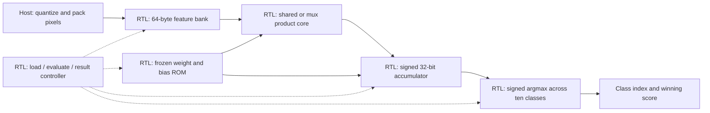

# Frozen digit-classifier workload

## Purpose and boundary

This workload tests whether the precision-configurable core is useful for an
actual inference task. A linear classifier evaluates ten signed dot products of
64 normalized pixels, adds a bias for each class, and returns the largest score.
All scoring, accumulation, bias addition and class selection execute in
`rtl/flexmac_classifier.v`. This is a small linear model, not a CNN accelerator.

The host converts raw pixels to quantized features and packs input bytes. Offline
Python fits the model and exports ROM constants and reference fixtures. Neither
training nor input normalization/quantization is implemented in hardware.
The Verilog testbench reads frozen files and drives the RTL directly; normal
verification does not import NumPy or scikit-learn.



This is a conceptual RTL block diagram, not a synthesized gate schematic.

## Frozen experiment

The source is scikit-learn's [8x8 digits dataset](https://scikit-learn.org/stable/modules/generated/sklearn.datasets.load_digits.html):
1,797 samples, ten classes and integer pixels from 0 to 16. This project uses its
own stratified split, not an official benchmark split or MNIST result.

- Seed: 20261027. Training: 1,078; calibration: 359; held-out test: 360.
- Normalize each pixel as `pixel / 8 - 1`.
- Fit multinomial logistic regression with C=1, lbfgs, max_iter=3000, tol=1e-10.
- For each precision, evaluate global weight clipping fractions
  `[1.0, 0.9, 0.8, 0.7, 0.6]` on calibration data only. Choose the most correct
  predictions; ties favor the larger clipping fraction.
- Once settings are selected, evaluate the test set once. Do not tune to it.

Exact split indices, selected scales, calibration candidate scores, package
versions and file hashes are in `model/digits/metadata.json`. Fitted floating
weights are retained in `floating_model.json` for inspection. Re-running training
on another numerical backend may differ slightly; the committed integer ROM and
fixtures define the bit-exact hardware experiment.

## Quantization and arithmetic

For B=8 or B=4, let L=2^(B-1)-1. The symmetric quantized range is [-L,L].
Hardware additionally supports the full two's-complement negative endpoint,
which is covered by the arithmetic tests.

```
input_scale = 1/L
weight_scale = max(abs(floating_weights)) * chosen_clipping_fraction / L
qx = clip(round_to_even(normalized_input / input_scale), -L, L)
qw = clip(round_to_even(weight / weight_scale), -L, L)
qb = round_to_even(bias / (input_scale * weight_scale))
score[class] = qb[class] + sum(qx[feature] * qw[class, feature])
prediction = lowest class index with the largest signed score
```

There is one input scale and one weight scale shared across all classes within
each precision. Therefore integer scores can be compared directly. Scores in
different precisions have different scales and must not be compared directly.
Softmax is unnecessary for argmax; outputs are scores, not probabilities.

The accumulator and stored biases are signed 32 bits. Arithmetic wraps modulo
2^32, matching the existing stream contract, but the exporter proves a simple
absolute bound over every possible quantized input: 223,820 in INT8 and 600 in
INT4. Neither model can overflow. INT4 packs feature 2k in the low nibble and
feature 2k+1 in the high nibble, with the same layout for weights. There are no
unused lanes because the model has 64 features.

## RTL interface and timing contract

All transfers occur on rising clock edges. Reset is synchronous active high;
ready/valid outputs and result payloads are masked while reset is asserted.

1. Accept `start_valid && start_ready`, capturing `mode4`.
2. Accept 64 feature bytes for INT8 or 32 packed bytes for INT4 using
   `feature_valid && feature_ready`. Gaps do not advance the index.
3. Reuse the buffered image across all ten classes. The engine consumes one
   product beat per cycle: 640 evaluation cycles in INT8 or 320 in INT4.
4. Assert `result_valid` with `result_class` and signed `result_score`. Hold
   stable until `result_ready`; no new command is accepted during the stall.

Without input gaps, command-acceptance to result-valid is 704 cycles in INT8 or
352 in INT4. These counts include feature loading and evaluation. They exclude
host quantization, weight training/export, result-consumption stalls and idle
time between transactions. There is no overlap of loading and evaluation.
They are cycle counts, not nanosecond latency or measured throughput in hertz.

Reset cancels partial loading, active computation and pending output. The
feature bank is not reset, but every used byte must be overwritten before
evaluation. Invalid result payloads are zero. Precision changes after a command
do not affect that transaction. `PRODUCT_IMPL=0` chooses shared partial products;
1 chooses the separate-unit mux baseline. ROM, storage and control are identical.
Both precision ROM banks exist together; INT4 selection does not physically
remove the INT8 model or halve total area.

## Model result and verified RTL replay

RTL replay reproduced these results in both implementations. See the
[verified classifier report](classifier_results.md) for cycles, coverage and CI provenance.

| Model | Correct / 360 | Accuracy | Drop from float | <=1 percentage-point budget |
| --- | ---: | ---: | ---: | --- |
| Floating reference | 345 | 95.83% | -- | Reference |
| INT8 | 345 | 95.83% | 0.00 pp | Pass |
| INT4 | 341 | 94.72% | 1.11 pp | **Fail** |

The INT4 result misses the budget by one additional error beyond the maximum
three-error increase allowed on 360 samples. This is a result to retain, not
an invitation to tune on the held-out set. It does not establish a statistically
significant general accuracy difference. A new quantization strategy would need
a separate predeclared experiment and fresh held-out evidence.

## Verification and reproduction

With Icarus on PATH, from the repository root:

```bash
bash scripts/check_classifier.sh
```

The self-checking Verilog benches verify both hardware implementations, both
precisions, all ten integer scores per image, predictions, winning scores,
input gaps, captured mode, output stalls and six reset cancellations per
implementation. A separate controlled ROM tests negative tied scores and a
positive winner against negative scores. An unsigned-comparison mutation must
compile and then fail the directed check. CSV files distinguish injected input
gaps from the 640/320 evaluation cycles. CI is the execution environment on the
current Windows machine, where local Icarus and Yosys are not installed.

Normal checks use only Python's standard library for manifest integrity and the
existing arithmetic orchestration. To reproduce offline model preparation in
a disposable environment:

```bash
python -m venv build/model-env
# Activate the environment using your shell's standard activation command.
python -m pip install -r model/requirements.txt
python scripts/export_digits.py
python -m unittest discover -s tests -v
```

Compare the generated integer fixtures and model metadata before accepting a
retrained model. Training dependencies are optional and absent from normal CI.
See `docs/research_plan.md` for the still-required library-mapped study.
