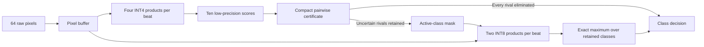

# Compact certificates with selective exact refinement

## Research question and status

Can a compact certificate avoid both the large conditioned residual ROM and the
cost of recomputing all ten INT8 classes on every uncertain input?

The candidate passed RTL replay, library mapping, timing and mapped replay in
[CI run 40838063746](https://github.com/jrmywm/FlexMAC/actions/runs/40838063746).
An independent source/data audit passed. It beats the remapped two-lane INT8
control on mean latency at substantial area cost, but the four-lane INT8 control
is both smaller and faster. **Reject this adaptive candidate as an efficiency
improvement for the current workload. Recommend four-lane INT8 when its modest
area increase over two lanes is acceptable.** The original engine and historical
results remain reference measurements.

## Measured decision

| Engine | Cell area (um2) | Mean cycles | Worst observed cycles | Tested period (ns) | Mean latency (us) | Worst observed latency (us) |
| --- | ---: | ---: | ---: | ---: | ---: | ---: |
| Two-lane INT8, separate comparison | 30,613 | 394 | 394 | 11.1328 | 4.3863 | 4.3863 |
| Compact selective refinement | 46,984 | 335.747 | 560 | 11.4453 | 3.8427 | 6.4094 |
| Four-lane INT8, separate comparison | 35,892 | 234 | 234 | 12.3438 | 2.8884 | 2.8884 |

The adaptive candidate reduces mean latency by 12.39% versus two lanes, but
increases area by 53.48% and observed worst latency by 46.12%. Four-lane INT8
reduces latency by 34.15% versus two lanes for 17.24% more area. Relative to
four-lane INT8, the adaptive candidate uses 30.90% more area and has 33.04%
greater mean latency. Its whole-engine area/latency tradeoff is dominated.

At the directly checked common 14 ns clock, mean latencies are 5.516 us,
4.700 us and 3.276 us, respectively. All three pass common-clock setup and hold
with zero reported electrical violations. These are pre-layout, typical-corner
cell areas and discrete tested periods with ideal clock/wires. They are not
physical signoff clocks, die areas, or power/energy measurements.

The two-lane RTL and arithmetic are unchanged. Its remapped area/period differ
slightly from the archived earlier study (30,454 um2 and 11.2891 ns); this new
driver reads a different ordered set of source modules. Netlist hashes differ,
so use the within-run controls for the percentages here. These are single
mapping realizations, not an exploration of synthesis variability. The large
four-lane advantage is observed in this run; broader process/library/workload
claims are unsupported.

The initial 32-bit low-score-storage candidate used 56,547 um2 with a 12.7344 ns
passing period and 4.2755 us mean latency. Using the proven 11-bit score range
reduced cell area by 16.91% and mean latency by 10.12%, with the same schedule
and decisions. This is a successful implementation optimization, although it
does not change the dominated outcome against four-lane INT8. Initial results
and their executed source revision are archived separately, not mixed with the
final measurements.

The four-lane control computes four signed INT8 products, adds them with a
balanced tree (17-bit pairs, 18-bit total), and accumulates into signed32. It
retains the registered final-score comparison. Its exact schedule is 64 input
cycles plus ten classes of 16 MAC cycles and one comparison: 234 cycles. This
is ordinary arithmetic parallelism, not a claim of architectural novelty.

Verification: 19 model/method unit tests; candidate RTL on all 1,437 existing
training/calibration inputs, checking 14,370 INT4 scores and every selected INT8
score; four-lane RTL on those same 1,437 inputs, checking every INT8 class score;
all 359 calibration frames per design in compiled gate replay; 17 explicitly
selected frames per design in Icarus four-state gate replay. Protocol, gaps,
invalid pixels, reset cancellation and output stalls are checked. An unsafe
elimination mutation is rejected. These do not constitute formal sequential
verification or a fresh held-out evaluation.

The existing bound construction is reused. This is a new experiment in this
repository, not an established claim of algorithmic novelty. Certified
quantization has prior art, including [Dang et al., AISTATS
2025](https://proceedings.mlr.press/v258/dang25a.html) and Kabaha and
Drachsler-Cohen's [guaranteed classifications and adaptive precision refinement,
OOPSLA 2025](https://doi.org/10.1145/3763118). The latter is particularly relevant:
it derives classification-consistency checks and refines precision when needed.
Our present question concerns the measured hardware cost of selectively
recomputing output classes for a small frozen INT8 reference. That distinction
does not establish novelty. A focused comparison of selective output refinement
is still needed before claiming a new algorithm.



This conceptual diagram shows processing phases. The INT4 and INT8 phases
reuse the same two shared product circuits.

## Why a different fallback policy

The conditioned engine spends 320 MAC cycles on INT4, then 640 on full serial
INT8 fallback. Its checker uses a large feature-conditioned residual table.
Merely shrinking that table does not solve the scheduling problem: a two-lane
INT8 baseline already needs only 320 MAC cycles.

This candidate uses two instances of the existing shared product circuit. Each
cycle computes four INT4 products or two INT8 products. It stores the ten INT4
scores, then tests each rival against the existing global pairwise threshold.
An inconclusive test retains that class for exact evaluation; it does not force
all ten classes to be recomputed.

## Decision guarantee

Let c be the lowest-index INT4 winner and let T[c,j] be the frozen threshold
derived over all 17 possible raw pixel values for every feature. The existing
derivation gives:

```
S4[c] - S4[j] >= T[c,j]  implies  S8[c] > S8[j].
```

If all rivals pass, return c. Otherwise evaluate the exact INT8 scores for c
and every rival that did not pass, then return the lowest-index maximum.

Every eliminated rival is strictly worse than c in INT8. Because c is retained
whenever exact evaluation is needed, no eliminated rival can win. Strict
elimination preserves any possible INT8 tie for exact evaluation. This certifies
the class decision, not equality of approximate and exact scores.

The certificate remains conditional on correct frozen arithmetic and inputs in
[0,16]. The screening script checks domain-wide final score extrema: INT8
[-212584,223820], INT4 [-568,600]. Thus the mathematical scores do not wrap a
32-bit accumulator for this model. No guarantee covers changed weights,
preprocessing, unsupported inputs or hardware faults. This mathematical argument
is not a formal proof of the complete sequential RTL.

## Initial feasibility screen

No training or test data is opened. Existing training/calibration raw pixels and
integer score fixtures are reused. Every reference score is recomputed from the
frozen weights and raw pixels before evaluating the schedule.
Independent unit checks also cover 365 constructed raw vectors: all 17 uniform
pixel values, two alternating extremes, 256 seeded random vectors and 90
class-pair residual-minimum witnesses. These are mathematical-model tests;
they are not additional RTL replay frames.

| Split | Samples | No exact classes needed | Mean exact classes |
| --- | ---: | ---: | ---: |
| Training | 1078 | 456 | 2.038 |
| Calibration | 359 | 134 | 2.318 |

There are zero decision disagreements with frozen INT8 in the offline screen.
This is observed agreement plus a separate domain-wide bound argument, not
independent held-out accuracy evidence.

The explicit RTL schedule includes 64 input beats, 160 INT4 MAC beats, ten
comparison states, nine class-initialization states, and ten certificate states.
A certified transaction therefore takes 253 cycles. A transaction refining k
classes takes 263 + 33*k cycles, including ten class-selection states. On the
calibration distribution the projection is 335.747 mean cycles, compared with
394 for the two-lane score-comparison baseline. The earlier first-pass estimate
of about 320 cycles omitted initialization and selection states; this document
uses the actual intended controller schedule.

At those projected counts the candidate's clock period must be less than
1.1735 times the two-lane baseline period to improve mean elapsed time. Worst
case is 593 cycles if all ten classes require exact evaluation; observed
calibration maximum is nine classes, or 560 cycles. This is an average-latency
experiment with potentially worse tail latency.

The new four-lane INT8 control needs 234 cycles. It tests whether straightforward
parallelism gives a better area/latency tradeoff than adaptive control. A gain
over two lanes alone does not establish superiority over this stronger control.

The ten stored INT4 scores and the captured candidate use 11 signed bits each,
justified by the domain extrema above. Exact refinement retains a 32-bit score
and accumulator. This saves 231 stored bits compared with 32-bit low-score and
candidate registers; physical saving still requires mapping.

The 90 used pair thresholds fit eight unsigned bits each (720 logical bits).
The conservative generated ROM interface remains 32 bits. These logical payload
figures are not physical area or mapped-cell estimates.

## Reproduction and acceptance criteria

```
python -m unittest discover -s tests -v
python scripts/screen_compact_refinement.py
bash scripts/check_compact_refine.sh
bash scripts/check_scorepipe.sh
STA=.tools/OpenSTA/build/sta python scripts/map_compact_refine.py
```

The workflow `compact-refinement.yml` installs the existing lightweight EDA
tools and restores the pinned timing-library/tool cache. It archives source
history, scoreboards, cycle traces, mapped-cell counts, setup/hold reports and
gate-level replays. All calibration frames must match their RTL decisions, flags
and cycle counts in a compiled two-state simulator with randomized initialization.
A separate Icarus four-state replay selects one example of every observed
predicted class and exact-refinement count, plus the first/last calibration
frames. Selection uses existing calibration metadata. The exact selected indices
are archived; this is not full-calibration four-state coverage or SDF simulation.

Measured results and audit are in [data/compact_refinement](data/compact_refinement).
`results.json` names the exact executed source commit; `run.json` records the CI
artifact and its verified ZIP hash. Mapped JSONs and netlists are gzip-compressed
in the archive. Full raw artifacts, including the pruned Liberty and executable
source bundle, can be downloaded from the linked CI run. After extracting the
artifact, run `python scripts/audit_compact_refine.py --evidence EXTRACTED_ROOT`.
The previously generated IEEEtran report describes the earlier precision and
scheduling study; this supplemental experiment has not been typeset into it.

Report whole-engine cell area, mean and worst latency at each directly tested
passing period, and latency at a common feasible clock. A useful efficiency
claim requires a meaningful Pareto tradeoff against both INT8 controls. Include
the cost of the extra model bank, stored scores, multipliers and control. If an
INT8 control is both smaller and faster, reject this candidate for this workload.
Power, energy, physical-layout and independent generalization claims remain
outside this experiment.
