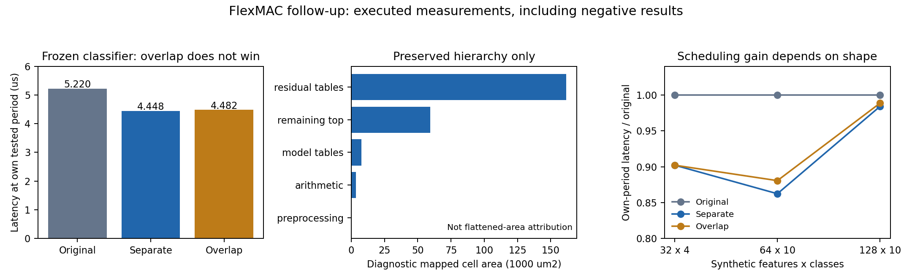
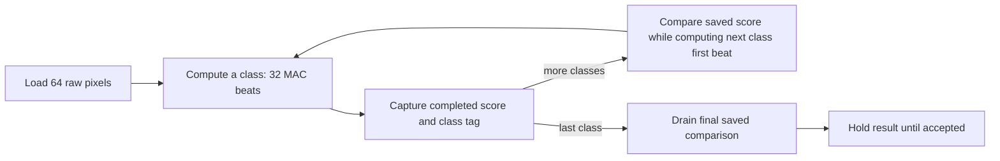

# Follow-up experiments

These experiments extend the frozen classifier study. The overlap experiment has passed simulation, mapping, two-state/four-state mapped replay, and independent evidence review. The area and synthetic studies have also passed CI and independent evidence review. Original RTL, fixtures and archived results remain the reference.

## Overlap

The added two-lane engine captures each completed score and its class. It compares that saved pair while executing the first MAC beat of the following class. The last score is drained in a separate cycle, before the result is exposed. The verified no-gap schedule is 64 accepted input cycles, 320 MAC cycles, and one final drain: 385 cycles from accepted command to valid result. All 359 calibration frames reproduce every INT8 class score in RTL and the expected decisions, flags and cycles in both mapped replay backends. `scripts/check_overlap.sh` runs both frozen baselines, the full 359-frame score and prediction replay, and an intentionally broken-tag negative control. `eda/overlap_study.json` reuses the pinned mapping and gate replay machinery; `.github/workflows/overlap-study.yml` preserves timing, source, and replay evidence.

## Adaptive area

`scripts/area_attribution.py` maps the existing adaptive engine twice using the same pinned library and ABC target: the standard flattened map and a hierarchy-preserved diagnostic map. It recursively counts each physical standard-cell instance in the latter and groups module-owned cells into arithmetic, model tables, residual tables, preprocessing, and remaining top-level logic. The remaining bucket includes feature storage, interval checking and control; it must not be split by guesswork. Its grouped totals exactly sum to the hierarchy-preserved total. This diagnostic total can differ from the flattened one because preserving boundaries limits optimization; buckets are not assignments of flattened cells. These are mapped cell areas, not physical memory macro areas or layout results. The measured diagnostic breakdown appears below; it identifies the dominant preserved block without assigning its share to the normal flattened map.

## Synthetic scaling

`eda/synthetic_study.json` defines three shapes and identical deterministic signed feature, weight and bias fixtures for all three schedules. Unlike the production raw-pixel classifier, the synthetic engine loads already quantized signed features at runtime and uses fixed synthetic weights and biases. It performs no pixel preprocessing or trained-model inference. Feature registers, fixed weight/bias tables, and read logic are part of every map. Internal score probes are used only by the RTL bench; they are not extra synthesis output ports. Synthesis may specialize fixed weight contents and optimization may differ by shape or schedule. Do not infer model accuracy, adaptive precision benefits, or general scalability from this bounded sweep.

`bash scripts/check_synthetic.sh` checks class scores against an independent integer scoreboard, exact cycle counts, result stalls, reset cancellation, signed extreme operands, ties and final-class winners. `python scripts/map_synthetic.py` maps and directly tests setup brackets and a shared passing clock for each shape using the existing constraints; timing is not estimated if tools are missing. `.github/workflows/synthetic-area-study.yml` records source bundle, logs, and artifacts. All nine configurations passed 24 runtime-input frames each, class-score checks, exact latency, stalls, reset cancellation and a rejected unsigned-comparison fault. Synthetic mapped netlists have not undergone functional replay; the production overlap engines have.

## Measured overlap tradeoff

| Engine | Cell area (um2) | Cycles | Passing setup period (ns) | Latency at own passing period (us) | Latency at common 15 ns (us) |
| --- | ---: | ---: | ---: | ---: | ---: |
| Original paired INT8 | 30,006.28 | 384 | 13.59375 | 5.2200 | 5.760 |
| Separate comparison | 30,454.21 | 394 | 11.2890625 | 4.4479 | 5.910 |
| Overlapping comparison | 30,794.53 | 385 | 11.640625 | 4.4816 | 5.775 |

Overlap recovers nine cycles, but its directly tested passing period is longer.
It is 0.759% slower and uses 1.118% more mapped area than the separate-comparison
engine at each design's passing period. At a common 15 ns it is 2.284% faster
than separate comparison, but 0.260% slower than the original. The separate
comparison remains the fastest complete engine in this experiment when each
is operated at its own passing setup endpoint. These are discrete tested
endpoints with very small positive margins, not practical signoff clocks.

Both historical baseline netlist hashes reproduce exactly. All three designs
pass common-clock setup and hold with zero reported electrical violations; none
meets the 10 ns mapping target. The overlap critical path still ends at
`accumulator[30]` (mapped cell `_5987_`), rather than best-score comparison.
Thus removing schedule bubbles did not eliminate the accumulation path.

Evidence: [CI run](https://github.com/jrmywm/FlexMAC/actions/runs/40807478848),
[archived table](data/overlap/mapped_comparison.csv), and
[independent audit](data/overlap/audit.json). All 359 images were replayed in
Verilator two-state and Icarus four-state for each engine. The deliberately
broken tag is rejected; its output is isolated from the valid references.

## Adaptive area diagnostic

| Preserved-hierarchy bucket | Mapped area (um2) |
| --- | ---: |
| Arithmetic | 3,588.44 |
| Model tables | 7,728.66 |
| Preprocessing | 317.80 |
| Remaining top-level logic | 59,542.11 |
| Residual tables and residual bias | 161,581.22 |
| **Diagnostic total** | **232,758.23** |

The residual-table/bias bucket is 69.4% of this diagnostic total. The normal
flattened map is 167,946.07 um2, reproducing the historical netlist exactly.
The diagnostic total is 38.6% larger because module boundaries prevent
cross-boundary optimization. **69.4% is not the residual share of the normal
flattened engine.** Nevertheless, the diagnostic identifies the residual-bound
representation as a major cost worth investigating, while the multiplier is a
small part of this diagnostic map. Remaining top-level logic includes pixel
storage, interval arrays/arithmetic, winner/checking logic and control; no more
precise attribution is claimed. The recursive cell counts were independently
compared with a flattened copy of the diagnostic netlist and reconcile exactly.
See [data](data/area_attribution/attribution.json).

## Bounded synthetic results

These fixtures use runtime signed INT8 inputs and fixed synthetic weights;
loading time is included. Each shape has a directly verified common clock
(14.5 ns, 16 ns, and 14 ns respectively). Own-period latency is different from
latency at that common clock. No model accuracy, adaptive acceptance, power,
physical closure, or population-wide architecture conclusion follows.

| Features x classes | Schedule | Cycles | Area (um2) | Passing period (ns) | Own-period latency (us) |
| --- | --- | ---: | ---: | ---: | ---: |
| 32 x 4 | Original | 96 | 22,022.4 | 13.12500 | 1.2600 |
| 32 x 4 | Separate | 100 | 23,836.6 | 11.36719 | 1.1367 |
| 32 x 4 | Overlap | 97 | 23,816.6 | 11.71875 | 1.1367 |
| 64 x 10 | Original | 384 | 34,022.6 | 14.45312 | 5.5500 |
| 64 x 10 | Separate | 394 | 35,255.1 | 12.14844 | 4.7865 |
| 64 x 10 | Overlap | 385 | 35,411.5 | 12.69531 | 4.8877 |
| 128 x 10 | Original | 768 | 55,111.6 | 12.30469 | 9.4500 |
| 128 x 10 | Separate | 778 | 56,376.6 | 11.95312 | 9.2995 |
| 128 x 10 | Overlap | 769 | 56,526.7 | 12.14844 | 9.3421 |

Separate comparison matches or beats overlap at the tested own-period endpoints
in all three shapes. Its gains against the original are about 9.8%, 13.8%, and 1.6%
for the three shapes respectively. This is a limited observation
for these fixed tables and mapping conditions. It is not monotonic scaling law:
ROM specialization, addressing and mapping differ across shapes. At the common
clock the original always has fewer cycles, followed by overlap and separate.

Evidence: [CI run](https://github.com/jrmywm/FlexMAC/actions/runs/40825890561),
[synthetic results](data/synthetic/results.json), and
[independent audit](data/synthetic/audit.json).

## Overlap schedule

This is a conceptual RTL schedule, not a waveform or synthesized schematic.
The first beat in the overlap box is part of the next class's 32 beats.

## Audit and reproducibility

The parent review corrected fault-test reference overwriting, the negative
control entry path, constant-only synthetic inputs, synthesis-visible debug
outputs, and area reconciliation. These fixes precede the cited passing runs.
The final audit checked source hashes, unchanged baseline netlist hashes,
replay CSV identity, measured cycle arithmetic, timing brackets, common setup/
hold, cross-schedule synthetic decisions, and diagnostic cell counts. Historical
results are retained. No claim of formal correctness or new research novelty
is made. All mapped results remain one-corner pre-layout estimates.
