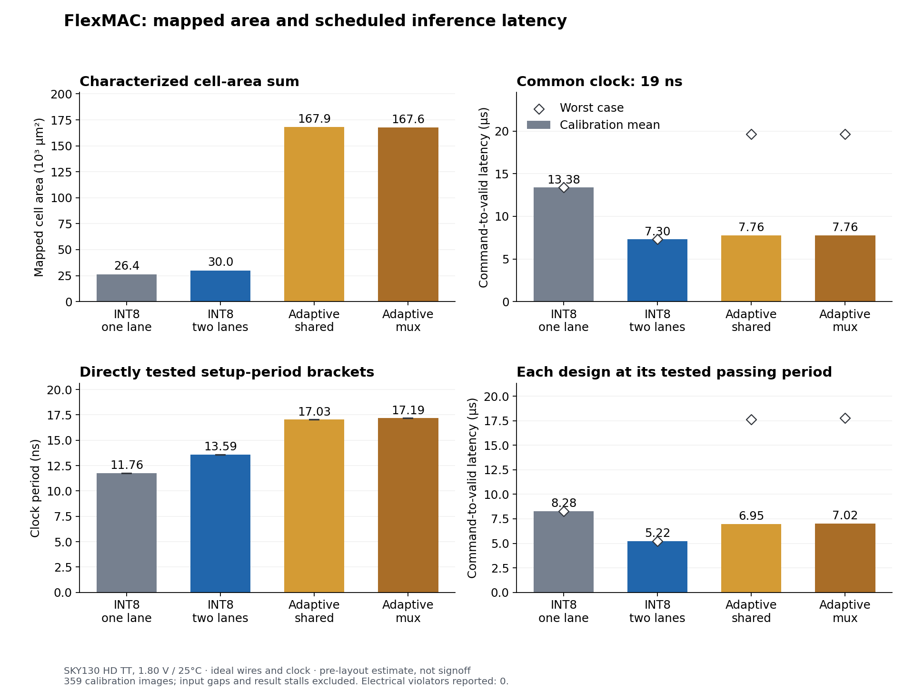

# Library-mapped comparison

The RTL architectures and frozen models are unchanged. This flow maps the four
raw-input engines into one characterized standard-cell library and tests whether
the generic-cell/cycle conclusions survive technology mapping. The flow is
implemented with the methods and limitations below.

## Result: choose the two-lane INT8 engine for this workload

[Mapped CI run 40475813403](https://github.com/jrmywm/FlexMAC/actions/runs/40475813403)
and [RTL regression 40475813443](https://github.com/jrmywm/FlexMAC/actions/runs/40475813443)
both passed at source `96141e7767723cfd53e6830a948e46bef05687d8`.
Mapping uses Yosys 0.33 and OpenSTA 3.1.0; replay uses Verilator 5.020 and
Icarus Verilog 12.0. The evidence snapshot and artifact provenance are linked below.

The complete two-lane INT8 engine adds 13.8% mapped cell area over single-lane
INT8 and reduces mean latency by 36.9% when each design uses its own directly
tested passing setup period. At a common 19 ns clock it reduces latency by
45.5%. Both adaptive versions cost about 5.6 times its mapped area and take
longer, even on certified frames (394 versus 384 cycles). This is evidence
against the current adaptive implementation's efficiency hypothesis.

| Engine | Cell area (µm²) | Sequential / combinational area (µm²) | Failing / passing setup period (ns) | Mean cycles | Worst cycles |
| --- | ---: | ---: | ---: | ---: | ---: |
| Single-lane INT8 | 26,357.78 | 8,187.85 / 18,169.93 | 11.71875 / 11.7578125 | 704.00 | 704 |
| Two-lane INT8 | 30,006.28 | 8,167.83 / 21,838.44 | 13.5546875 / 13.59375 | 384.00 | 384 |
| Adaptive shared | 167,946.07 | 22,581.66 / 145,364.42 | 16.9921875 / 17.03125 | 408.26 | 1,034 |
| Adaptive mux | 167,561.96 | 22,581.66 / 144,980.30 | 17.1484375 / 17.1875 | 408.26 | 1,034 |

| Engine | Mean / worst latency at 19 ns (µs) | Mean / worst latency at own passing period (µs) | Common setup / hold worst slack (ns) |
| --- | ---: | ---: | ---: |
| Single-lane INT8 | 13.376 / 13.376 | 8.278 / 8.278 | +7.2675 / +0.1217 |
| Two-lane INT8 | 7.296 / 7.296 | 5.220 / 5.220 | +5.4092 / +0.1372 |
| Adaptive shared | 7.757 / 19.646 | 6.953 / 17.610 | +1.9735 / +0.1521 |
| Adaptive mux | 7.757 / 19.646 | 7.017 / 17.772 | +1.8473 / +0.1521 |



All four designs **fail the 10 ns mapping target**. That target is never used
as a claimed operating point. Every common-clock analysis reports positive
setup and hold slack and zero max-slew/max-capacitance violations under the
chosen assumptions. Ideal-clock hold results do not establish post-CTS hold
closure. The shortest-period bracket is a setup-only search; hold slack at its
passing endpoint is also positive in this run.

The common-clock table controls for period; the own-period table accounts for
each design's timing cost. The two-lane engine has a longer clock period than
single-lane, so its elapsed-time gain is smaller than its cycle-count gain.
Adaptive results are weighted by 351 certified / eight fallback calibration
frames. They do not measure held-out accuracy, a large neural network, or a
production input distribution. Ground-truth accuracy remains the frozen
360-image study: float/INT8 345 correct, INT4 341 correct.

The sequential-area breakdown is based on characterized flip-flop/latch cell
types; reset/enable logic is counted as combinational area. Adaptive overhead
is predominantly combinational (about 145,000 µm²), not just additional flops.
The total includes residual/model ROM logic, quantization, arithmetic, buffering
and control. No module-by-module area attribution is claimed after flattening.
The worst reported paths are register-to-register, with long carry/mux logic
in their cell traces. Assigning each segment to a named RTL operation would
require a separate correspondence analysis.

The shared and mux adaptive versions differ by only 0.23% in mapped area. A
single mapping/library run cannot establish a robust advantage from that gap.
There is no evidence here of energy savings or a new arithmetic technique.
The useful contribution is the verified implementation and a comparison that
changes the design choice after counting the whole engine.

## Fixed tools and library

`eda/toolchain.json` pins OpenSTA, CUDD, the SKY130 HD typical-corner library and
all optimization/timing assumptions. The library is the OpenSTA example
`sky130hd_tt.lib.gz`: SKY130 `sky130_fd_sc_hd__tt_025C_1v80`, 25 C and 1.80 V.
Its compressed SHA-256 is
`210e56be3a3a0907b5241a34d277f664cf4b4d91dcb49a27ff813df4406a5889`.
The original and modified library hashes, source hashes and tool versions are
recorded with each run. CI builds timing tools on Linux; no local vendor FPGA
suite or full PDK installation is needed.

`eda/architectures.json` locks the four parameter sets and hashes of the RTL
and residual-model table against verified baseline
`ad8f5d5e91190fdaaaf80ba636df1f5fc2d8349a`. Mapping refuses architecture changes;
this phase changes the implementation flow and test instrumentation only.

Library units are checked explicitly: ns and pF. Cells in the lpflow/probe
families are excluded from mapping. Liberty wire-load tables, selections and
default wire-load settings are removed from the analysis/mapping copy. Thus the
ideal-wire assumption is explicit, rather than relying on each tool's implicit
handling of library defaults. Cell timing and pin capacitance tables remain.
The original library is retained unchanged in the pinned tool checkout.

## Mapping

All four configurations use `synth -flatten -noabc`, `dfflibmap`, then one
Liberty-based ABC mapping with a 10 ns optimization target. ABC's constraint
uses `buf_2` input driving and 10 fF load. The target is optimization effort,
not evidence that a 10 ns clock is met. There is no RTL pipelining, retiming
request, arithmetic change or model retraining in this experiment.

Every mapped cell must be a known member of the pruned library. Area is the sum
of characterized cell areas, reported in the SKY130 library's square-micrometre
convention. Sequential and combinational contributions and cell counts are
separated. These are cell areas, not placed core/die area or routing utilization.

## Timing constraints

Each netlist is linked in OpenSTA with one clock and the same SDC template:

- Ideal clock network with explicit 0.10 ns transition, setup uncertainty 0.10 ns,
  hold uncertainty 0 ns.
- Input/output maximum external budgets: 20% of the tested clock period each.
- Input/output minimum delays: 0 ns.
- `sky130_fd_sc_hd__buf_2`, output pin X, for data-input driving.
- 0.010 pF (10 fF) output load. ABC uses 10.0 because its constraint load unit is fF.
- Reset is synchronous data and is timed. No false paths or multicycle paths.
- No extracted wires, placement, clock tree, package model or clock skew.

The script checks STA errors and incomplete-constraint diagnostics, requires
register-to-register paths, and cross-checks the four path classes against the
global worst setup slack. A deliberately tight 0.25 ns clock must fail.

The setup limit is bracketed by repeated COMPLETE STA runs with regenerated
I/O budgets. The bracket has a failing lower endpoint and directly tested
passing upper endpoint, at most 0.05 ns apart. It is not inferred by subtracting
one slack from a clock period. It is a setup-period bracket under these
assumptions, not a signoff maximum frequency.

A common clock is selected by rounding 110% of the largest passing bracket
endpoint up to the next 0.5 ns. Every SAME mapped netlist is then analyzed again
at that exact period, with direct setup and hold checks. Max-slew/capacitance
violators are reported too; positive setup/hold slack does not establish full
electrical closure if those constraints fail.

Both common-clock latency and each design's latency at its own tested passing
period are recorded. Cycles come from the same 359-image calibration replay;
known injected input gaps are removed from the no-gap latency statistic.
Result stalls after valid and idle command turnaround are excluded. Mean adaptive
latency is calibration-weighted and is not a new held-out performance estimate.

## Mapped functional replay

Liberty Boolean/flip-flop functions expand each mapped netlist into executable
zero-delay logic. A black-box mode of the existing Verilog bench drives the
same raw pixels, handshakes, gaps, stalls, invalid inputs and reset scenarios.
Every output class, fallback flag and exact cycle count must match the RTL CSV,
with 359 valid frames per design in compiled Verilator simulation. Verilator is
used as a two-state simulator with randomized initialization (seed 20261027).
Separate four-state Icarus simulation covers all 359 frames for each INT8 baseline,
and all eight calibration fallbacks plus one certified example for each of the ten
INT8 predicted classes for each adaptive design (18 frames). Both backends run the
bench's reset, invalid-input and output-stall checks. The adaptive four-state subset
is not equivalent to full four-state replay or formal equivalence. The first full
Icarus adaptive attempt exceeded a ten-minute wall-clock limit; the split coverage
makes this cost explicit. Logs and coverage indices are retained even on failure.
Internal class scores/intervals are checked in
the RTL regression; they are not observable probes in the mapped replay.

This is a functional check of what mapping produced. It does not use SDF, prove
all possible inputs/control sequences, measure glitches or validate real-cell
timing. Hardware-initialization and layout effects remain outside this flow.

## Run and inspect

The `Mapped area, timing and replay` workflow installs the lightweight EDA/build
tools and caches the pinned timing-tool build. It runs independently of the
existing RTL/generic verification workflow. Both must pass before reporting the
study complete.

Mapping produces one input artifact. Four independent replay jobs check the
configurations; a final job rechecks source/netlist/CSV hashes and aggregates only
complete passing results. This prevents a timing-only run being labeled verified.

With those tools available, from the repository root:

```bash
bash scripts/build_timing_tools.sh  # once, if tools are not built
bash scripts/check_adaptive.sh    # golden RTL replay
export STA="$PWD/.tools/OpenSTA/build/sta"
python scripts/check_mapping.py
python scripts/check_mapped.py
```

The mapping manifest, library hashes, netlists, scripts/SDCs, search logs, common
clock reports, mapped replay results and CSV table are under `build/map/` and
`build/mapped_comparison.csv`. CI uploads them with a source-history bundle.
Missing tools or library inputs are reported as blocked, not a passing result.

The committed [evidence snapshot](data/mapping/) retains the result table,
timing searches, common-clock constraints/reports, cell breakdowns and replay
CSVs/logs. Its provenance file records the measured source revision, CI artifact
checksum and hashes of the committed files. Full mapped netlists, the expanded
gate models and Liberty copy remain in the CI artifact. Historical generic
snapshots are preserved in their original directories.

To regenerate the four-panel scientific figure from the committed snapshot:

```bash
python -m pip install -r docs/requirements-figures.txt
python scripts/plot_mapping.py
```

Plotting needs no EDA tools. The plot script requires completed mapping metadata
and four passing mapped-replay reports; it does not substitute for those checks.

Power/energy, multiple process/voltage/temperature corners, wire parasitics,
physical optimization, routed area and signoff are not measured. A better result
here supports a bounded pre-layout comparison, not a fabrication-ready chip.

Primary tool references: [OpenSTA](https://github.com/parallaxsw/OpenSTA),
[OpenSTA timing examples and units](https://github.com/The-OpenROAD-Project/OpenSTA/blob/master/doc/Examples.md),
[Yosys 0.33 ABC constraints](https://github.com/YosysHQ/yosys/blob/yosys-0.33/passes/techmap/abc.cc),
[SKY130 library documentation](https://skywater-pdk.readthedocs.io/en/main/contents/libraries.html),
and [Verilator initialization and simulation options](https://verilator.org/guide/latest/exe_verilator.html).
