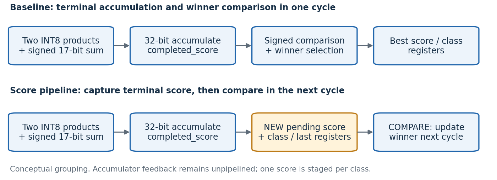
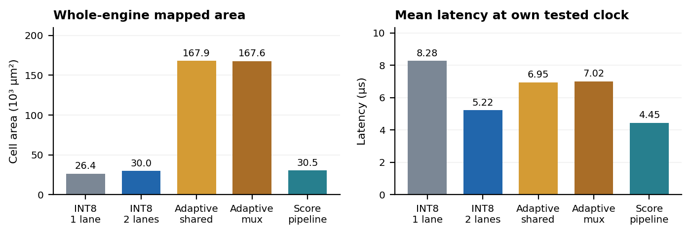

# FlexMAC: Precision Adaptation, Parallel INT8, and a Measured Pipeline Tradeoff

Jeremy W. M. (jrmywm) | Independent technical report | 28 October 2026

**Abstract.** FlexMAC compares precision adaptation with straightforward parallelism on a frozen ten-class digit classifier. An INT4-first engine uses conservative, input-conditioned score bounds to certify agreement with INT8, otherwise rerunning INT8. It certifies 351 of 359 calibration images, but its complete mapped implementation is larger and slower than a two-lane INT8 baseline. A subsequent register boundary separates completed-score comparison from accumulation. In a matched SKY130 typical-corner experiment, this change reduces no-gap latency from 5.220 to 4.448 microseconds at each design's directly tested passing period, with 1.49% additional cell area. At a common 15 ns clock, its ten additional cycles instead increase latency by 2.60%. These verified, pre-layout results demonstrate the importance of counting certificate hardware and clock-period costs; they establish neither energy savings nor production timing closure.

## 1. Motivation and related work

The motivating question is whether lower precision remains useful after paying for preprocessing, buffering, decision certification, fallback, and control. A MAC-only comparison cannot answer that question. FlexMAC therefore progresses from a frozen classification workload to complete raw-input engines, characterized-cell mapping, mapped functional replay, and a timing-driven follow-up [8]. This report consolidates those experiments without claiming peer review or algorithmic novelty.

The contributions are an explicit agreement certificate with a bounded input domain; a verified full-engine comparison that rejects the current adaptive implementation's efficiency hypothesis; and a matched pipeline experiment that quantifies an area, cycle, and elapsed-time tradeoff. Negative results are retained alongside the improvement.

Bit Fusion composes bit-level processing elements to match varying DNN precision requirements [1]. It provides architectural context, rather than a directly comparable baseline for this small linear model. Dang et al. derive quantization-robustness guarantees using bilinear optimization and interval-bound methods [2]; their different method establishes relevant prior art for certified quantization. NVDLA illustrates the broader system scope of configurable CNN acceleration, including computation blocks, buffering, and memory interfaces [4]. FlexMAC does not reproduce those systems or compare performance across their technologies.

<!-- pagebreak -->

## 2. Frozen workload and conservative agreement

The workload uses the 1,797-image, 8-by-8 digits dataset distributed by scikit-learn [3]. A project-specific stratified split with seed 20261027 assigns 1,078 training, 359 calibration, and 360 held-out images. Pixels are integers from 0 through 16. Multinomial logistic regression uses C=1, lbfgs, 3,000 maximum iterations, and tolerance 1e-10. Calibration selects a global weight-clipping fraction separately for each precision. Integer weights, biases, split indices, scales, and fixtures are frozen [8].

| Frozen model | Correct / 360 | Accuracy | Drop from float |
| --- | ---: | ---: | ---: |
| Floating reference | 345 | 95.83% | Reference |
| INT8 | 345 | 95.83% | 0.00 pp |
| INT4 | 341 | 94.72% | 1.11 pp |

INT4 misses the predefined one-percentage-point budget. This finite sample does not establish a statistically significant accuracy difference. The adaptive study subsequently reuses calibration data; its acceptance rate is not independent test accuracy.

Each class score is a bias plus 64 signed products. Frozen preprocessing rounds ties to even after normalizing p/8-1. Scores use signed 32-bit wrap semantics. Exported absolute bounds of 223,820 for INT8 and 600 for INT4 establish that these frozen models cannot overflow, although directed arithmetic tests separately exercise the wrap contract.

For positive K=366, define residuals and condition their extrema on the observed INT4 bin v:

```text
p in {0,...,16}; v = x4(p); i in {0,...,63}
r(c,i,p) = x8(p) w8(c,i) - K x4(p) w4(c,i)
m(c,i,v) = min r(c,i,p), over p with x4(p)=v
M(c,i,v) = max r(c,i,p), over p with x4(p)=v
d(c) = b8(c) - K b4(c)
L(c) = K S4(c) + d(c) + sum_i m(c,i,v_i)
U(c) = K S4(c) + d(c) + sum_i M(c,i,v_i)
L(c) <= S8(c) <= U(c)
Accept candidate c only if L(c) > U(j), all j != c.
```

Each actual residual belongs to its conditioned interval; summing these inequalities proves containment. Strict separation therefore ensures the unique INT8 winner. It certifies agreement with the frozen INT8 classifier, not correctness against the digit label. Failed certification triggers exact INT8 evaluation. The derivation assumes supported raw pixels, unchanged models, and correct arithmetic and control.

<!-- pagebreak -->

## 3. Architecture and register placement

All compared raw-input engines accept 64 five-bit pixels through ready/valid handshakes and retain the frame for computation. Verilog lookup tables implement frozen preprocessing. Pixels above 16 produce an input error after collection. Synchronous reset cancels the transaction; results remain stable under backpressure. Loading and evaluation do not overlap, and a new command waits until the current result is consumed [8].

Single-lane INT8 evaluates 640 products after 64 loading cycles, giving 704 command-to-valid cycles without gaps. Two-lane INT8 evaluates two products per cycle, taking 320 evaluation cycles and 384 cycles overall. Both calculate identical frozen INT8 scores and choose the lowest class index on ties.

The adaptive variants first evaluate packed INT4 while accumulating residual lower and upper bounds. A ten-cycle checker either accepts the INT4 candidate or starts a 640-cycle INT8 rerun from retained raw pixels. Certified frames take 394 cycles; fallbacks take 1,034. Shared and mux variants differ in their configurable product implementation. The residual table contains 9,600 used combinations with two 13-bit bounds each, or 249,600 logical bits before synthesis. Those bits are representation size, not silicon area; mapped cost includes ROM logic, intervals, quantization, arithmetic, and control.



The follow-up targets the two-lane baseline's measured path through accumulation and best-score comparison. It registers the completed class score and class tag, then performs comparison in an explicit subsequent state. The accumulation feedback loop still accepts one product pair per evaluation cycle; the new register is at the completed-score boundary. Ten comparison states increase the schedule from 384 to 394 cycles. Raw inputs, weights, quantization, signed arithmetic, and tie behavior remain unchanged.

The original host-quantized fixed INT4 interface takes 352 cycles, including 32 packed input bytes. It excludes host quantization and has neither raw-input checking nor the adaptive certificate. Comparing that count directly with the raw adaptive engine's 394 cycles would mix interface and functionality costs.

<!-- pagebreak -->

## 4. Verification and mapping methodology

RTL regression checks frozen class scores and predictions, interval containment, certificate decisions, exact cycle counts, input gaps, output stalls, invalid pixels, and reset cancellation. The pipeline bench additionally checks pending class tags, comparison-state resets, and final-class publication. Directed tests cover signed ties and arithmetic/control corner cases. These tests support implementation correctness without constituting formal equivalence.

Mapped replay uses executable zero-delay models expanded from library Boolean and flip-flop functions. Coverage differs deliberately. In the original four-design study, both INT8 engines replay all 359 calibration frames in Verilator 5.020 two-state simulation and Icarus 12.0 four-state simulation. Each adaptive engine replays all 359 frames in two-state simulation, but only 18 in four-state simulation: all eight fallbacks and one certified example for each of ten predicted classes. This subset followed a full adaptive Icarus attempt exceeding its time limit. In the separate pipeline study, both the pipeline variant and matched two-lane baseline replay all 359 frames in both simulators. Mapped checks compare outputs, flags, and cycles; internal score checks belong to RTL regression [8].

Yosys 0.33 performs flattened synthesis, flip-flop mapping, and Liberty-based ABC mapping with a 10 ns optimization target [5]. OpenSTA 3.1.0 analyzes a pinned SKY130 high-density library at typical process, 25 degrees C, and 1.80 V [6,7]. Characterized cell areas are summed; these are not placed core areas. Library wire-load defaults are removed to make ideal wires explicit.

Every design uses ideal clocks, 0.10 ns clock transition, 0.10 ns setup uncertainty, zero hold uncertainty, external input/output maximum delays of 0.2 times the tested period, zero minimum delays, buf_2 input driving, and 10 fF output loads. Synchronous reset is timed. There are no false or multicycle paths.

Repeated complete timing runs bisect a failing/passing setup bracket to at most 0.05 ns. Passing endpoints are directly tested with regenerated external budgets. Common periods round 110% of the largest passing endpoint upward to 0.5 ns: 19 ns for four designs, 15 ns for the pipeline pair. All designs fail the 10 ns target. Latencies exclude injected input gaps, result-consumption stalls, and idle turnaround.

<!-- pagebreak -->

## 5. Measured results

The archived four-design CSV gives the following complete-engine results. Mean adaptive cycles weight 351 certified frames and eight fallbacks; they describe the calibration replay distribution [8].

| Raw-input engine | Area (µm²) | Passing period (ns) | Mean / worst cycles | Mean own-period latency (µs) |
| --- | ---: | ---: | ---: | ---: |
| Single-lane INT8 | 26,357.78 | 11.7578125 | 704 / 704 | 8.278 |
| Two-lane INT8 | 30,006.28 | 13.5937500 | 384 / 384 | 5.220 |
| Adaptive shared | 167,946.07 | 17.0312500 | 408.26 / 1,034 | 6.953 |
| Adaptive mux | 167,561.96 | 17.1875000 | 408.26 / 1,034 | 7.017 |

Two-lane INT8 beats both adaptive implementations despite their 97.77% certification rate. Adaptive cell area is approximately 5.6 times larger, and even certified frames exceed the two-lane baseline's cycle count. At the four-design common 19 ns period, mean latencies are respectively 13.376, 7.296, 7.757, and 7.757 microseconds. The complete-engine evidence overturns the favorable impression from acceptance rate alone.

The separate matched experiment reproduces the baseline's exact netlist hash, area, and timing bracket before evaluating the new boundary:

| Pipeline comparison | Area (µm²) | Cycles | Passing period (ns) | Own-period latency (µs) | At 15 ns (µs) |
| --- | ---: | ---: | ---: | ---: | ---: |
| Two-lane baseline | 30,006.2784 | 384 | 13.5937500 | 5.220000 | 5.760 |
| Registered comparison | 30,454.2080 | 394 | 11.2890625 | 4.447891 | 5.910 |



The pipeline saves 14.791% own-period latency for 1.493% additional cell area, adding 38 sequential cells. At a common period it is 2.604% slower. Thus its benefit depends on exploiting the shorter feasible clock. The reported worst endpoint changes from best_score[0] to accumulator[30], consistent with separating score comparison from accumulation. The measured result supports this boundary placement, not an unmeasured further optimization.

<!-- pagebreak -->

## 6. Discussion, limitations, and conclusion

Precision reduction creates opportunity only when its supporting machinery costs less than the work saved. Here, a high certificate acceptance rate does not compensate for residual-table logic and a slower complete engine. Straightforward INT8 parallelism is the stronger original design; registering its score comparison then improves elapsed time under the stated timing model.

Passing setup slacks at the matched endpoints are only +0.002972 ns and +0.005231 ns. These tiny positive margins reflect discrete search resolution, not practical signoff margin. Common-clock setup and hold pass with no reported maximum-slew or capacitance violations, but ideal-clock hold checks do not establish clock-tree closure. Replay has no SDF and does not measure physical timing or glitches.

The evidence covers one linear model and one typical library corner. It includes no placed-and-routed implementation, measured power, energy, FPGA result, SoC integration, or formal proof. Calibration-based architecture exploration provides no new held-out accuracy evidence. Broader workload, independent evaluation, and physical implementation would be needed before generalizing. Within this boundary, FlexMAC provides a reproducible example of rejecting an expensive adaptation strategy and validating a conventional pipeline change with explicit tradeoffs.

### References

[1] H. Sharma et al. Bit Fusion: Bit-Level Dynamically Composable Architecture for Accelerating Deep Neural Networks. arXiv:1712.01507, 2017, revised 2018. [Paper](https://arxiv.org/abs/1712.01507).

[2] H. Dang, M. R. Wicker, G. Botterweck, and A. Patane. Certifiably Quantisation-Robust training and inference of Neural Networks. AISTATS, PMLR 258:5104-5112, 2025. [Paper](https://proceedings.mlr.press/v258/dang25a.html).

[3] scikit-learn. load_digits dataset documentation. [Documentation](https://scikit-learn.org/stable/modules/generated/sklearn.datasets.load_digits.html).

[4] NVIDIA. NVDLA Hardware Architectural Specification. [Specification](https://nvdla.org/hw/v1/hwarch.html).

[5] YosysHQ. Yosys 0.33 ABC integration source. [Source](https://github.com/YosysHQ/yosys/blob/yosys-0.33/passes/techmap/abc.cc).

[6] Parallax Software. OpenSTA. [Repository](https://github.com/parallaxsw/OpenSTA).

[7] SkyWater PDK. SKY130 library documentation. [Documentation](https://skywater-pdk.readthedocs.io/en/main/contents/libraries.html).

[8] jrmywm. FlexMAC source and archived evidence. [Repository](https://github.com/jrmywm/FlexMAC). Original mapping: source 96141e7767723cfd53e6830a948e46bef05687d8, [run 40475813403](https://github.com/jrmywm/FlexMAC/actions/runs/40475813403), [snapshot and provenance](https://github.com/jrmywm/FlexMAC/tree/main/docs/data/mapping). Pipeline: source 8e9065cb147d38b66423997e6d960a7239d8f5e9, [run 40613482958](https://github.com/jrmywm/FlexMAC/actions/runs/40613482958), [snapshot and provenance](https://github.com/jrmywm/FlexMAC/tree/main/docs/data/scorepipe).
