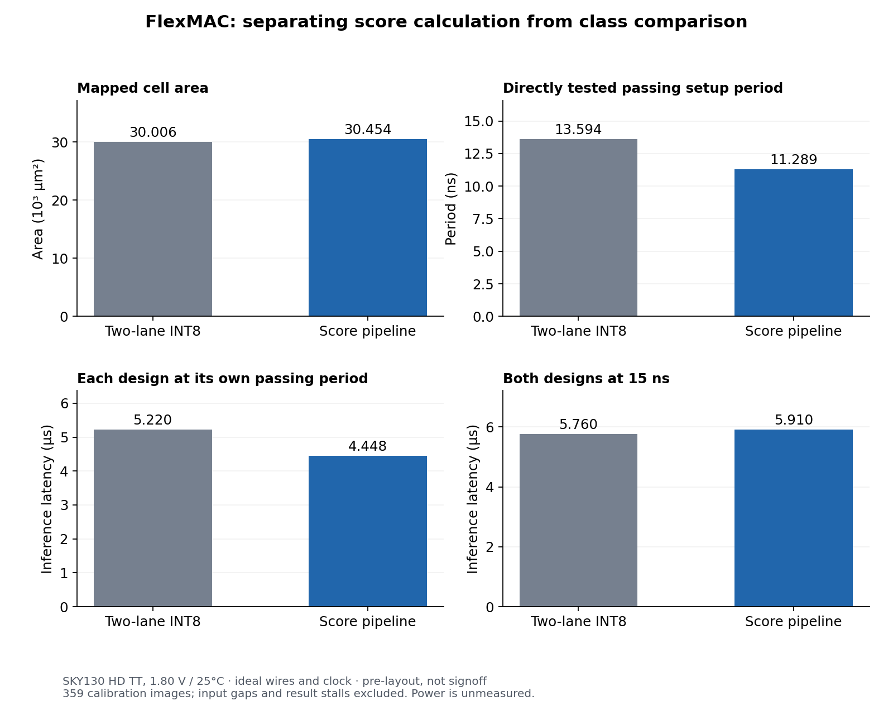

# Score-comparison pipeline experiment

The two-lane INT8 baseline computes the completed class score and compares it
with the stored best score in the same clock cycle. The saved mapped timing
path starts at `index[2]` and ends at `best_score[0]`, passing through accumulator
carry logic and best-score comparison. Its directly tested passing setup period
is 13.59375 ns, with 384 command-to-valid cycles and 5.220 microseconds latency.
See the historical [mapped study](mapped_study.md) for that measured baseline.

The new `flexmac_int8x2_scorepipe` variant stores a completed class score and
its class tag before comparing it against the previous best score. An explicit
comparison state adds one cycle per class. The accumulator still accepts one
pair of signed INT8 products per evaluation cycle, with no added register in
its feedback loop. The raw-pixel interface, frozen weights, quantization,
32-bit wrap semantics and lowest-index tie winner remain the same.

The expected no-gap schedule is 64 input cycles plus ten classes times
(32 accumulation cycles + one comparison cycle): **394 cycles per image**.
Invalid input still returns an error after input collection; result stalls
occur after valid and are excluded from command-to-valid latency.

This is a test of whether removing comparison from the accumulation path offsets
the extra cycles and registers. To beat 5.220 microseconds at 394 cycles, the new
design needs a tested passing period below 13.24873 ns. A 10% latency reduction
would require approximately 11.92386 ns. These are break-even calculations,
not predictions of the new timing result.

## Verification and measurement

`bash scripts/check_scorepipe.sh` replays the baseline and new engine on the same
359 calibration images and frozen INT8 scores. The new Verilog bench checks
class scores, pending class tags, exact cycles, invalid pixels, reset during
accumulation and comparison, final-class handling and output backpressure.
This is implementation verification on calibration inputs, not new held-out
accuracy evidence.

The independent `Score pipeline area, timing and replay` CI workflow uses the
same pinned SKY130 HD library, Yosys/ABC settings and OpenSTA constraints as the
original study. It remaps both designs in one run, directly tests their setup
period brackets and a common clock, and performs full 359-image two-state and
four-state mapped replay for both engines. The original four-design study and
its archived evidence remain the historical comparison.

```bash
bash scripts/check_scorepipe.sh
export STA="$PWD/.tools/OpenSTA/build/sta"
python scripts/check_mapping.py --study eda/scorepipe_study.json
python scripts/check_mapped.py --study eda/scorepipe_study.json
```

## Verified result

[Experiment CI run 40613482958](https://github.com/jrmywm/FlexMAC/actions/runs/40613482958)
and [full RTL regression 40613482932](https://github.com/jrmywm/FlexMAC/actions/runs/40613482932)
passed at source `8e9065cb147d38b66423997e6d960a7239d8f5e9`.
The same-run baseline reproduces the historical baseline's exact mapped-netlist
SHA-256, area and setup bracket. Neither the model nor the baseline RTL changed.

| Measure | Two-lane INT8 baseline | Registered score comparison |
| --- | ---: | ---: |
| Mapped cell area (µm²) | 30,006.28 | 30,454.21 |
| Sequential / combinational area (µm²) | 8,167.83 / 21,838.44 | 8,928.56 / 21,525.64 |
| Mapped cells / sequential cells | 3,226 / 408 | 3,365 / 446 |
| Failing / passing setup period (ns) | 13.5546875 / 13.59375 | 11.25 / 11.2890625 |
| Setup / hold slack at passing period (ns) | +0.002972 / +0.137218 | +0.005231 / +0.115955 |
| No-gap cycles, every valid frame | 384 | 394 |
| Latency at own tested passing period (µs) | 5.220 | 4.448 |
| Latency at common 15 ns period (µs) | 5.760 | 5.910 |
| Setup / hold slack at common period (ns) | +1.409223 / +0.137218 | +3.716170 / +0.115955 |

The new variant reduces complete no-gap inference latency by **14.79%** at
each design's own tested passing period, with **1.49% more cell area**. It adds
38 sequential cells and ten cycles. At the common 15 ns clock its latency is
**2.60% worse**; the gain depends on using the shorter feasible clock period.
The common period is selected from these two designs using the same 110%-then-
round-up rule as the earlier study, whose four-design common period was 19 ns.



Both designs still fail the 10 ns mapping target. The directly tested common
clock passes setup and hold, with zero reported max-slew/max-capacitance
violations. The tiny positive setup slacks at the searched endpoints represent
the discrete search resolution, not practical implementation margin.

The old worst path ended at `best_score[0]`. In the new mapped netlist the worst
path ends at `accumulator[30]` (`_5931_/D`), confirming that accumulation now
limits the reported setup path after score comparison was separated. This
explains why further clock improvement would require a different optimization;
the existing report does not establish an achievable period for such a change.

All 3,590 calibration class scores and 359 predictions match frozen INT8
references in RTL. Every frame takes exactly ten more cycles than its matched
baseline frame, including the known input gaps. Both mapped engines pass all
359 frames in Verilator 5.020 (two-state, initialization seed 20261027) and
Icarus 12.0 (four-state), with exact predictions, flags and cycle counts. Both
backends check input errors, reset cancellation and output stalls. The new bench
also targets reset during the first and final COMPARE cycles. RTL-only directed
register-level tests exercise score wrap, negative first-class initialization,
ties and final-class publication; these are additional component/control tests,
not claims that the frozen digit inputs reach signed32 overflow.

The [evidence snapshot](data/scorepipe/) contains CSVs, cell counts, timing
constraints/reports, search endpoints and replay results. Its provenance records
the original CI artifact digest and hashes of the normalized snapshot files.
Full netlists, gate models, Liberty and source history remain in the artifact.
To regenerate the figure, install `docs/requirements-figures.txt` and run
`python scripts/plot_scorepipe.py`.

This is an established pipeline technique applied to a measured bottleneck.
The contribution is the verified architecture change and the quantified area,
cycle and latency tradeoff. Results remain pre-layout, one typical corner,
ideal wires and clock, without measured power, physical implementation or
signoff. Calibration replay is not new held-out accuracy evidence.
