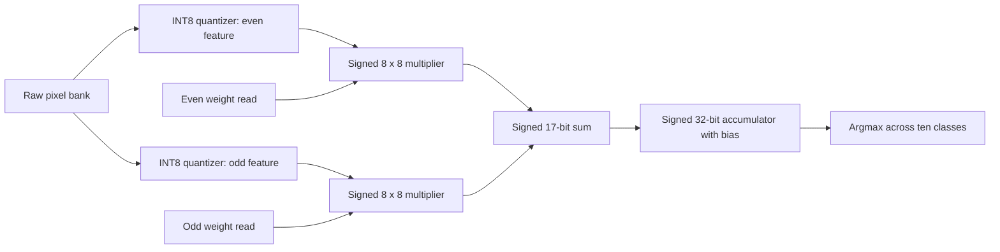

# Two-lane INT8 baseline

[CI run 40465335020](https://github.com/jrmywm/FlexMAC/actions/runs/40465335020)
passed at source `0625f48fcbf80a646427eabcd06f56bc03953cec`.
The [evidence snapshot](data/two_lane/) records logs, CSVs, source hashes and
artifact provenance. This comparison supersedes the earlier recommendation to
optimize the certificate before checking ordinary parallelism.

## Purpose

The adaptive engine spends substantial hardware on a certificate to avoid some
INT8 work. This baseline asks whether spending additional hardware on ordinary
INT8 parallelism is a better choice for the same frozen linear classifier.

It uses the same raw-pixel interface, 64-pixel buffer, preprocessing LUTs,
input-range checks, bias/accumulator widths, signed argmax, reset semantics and
result handshake as the single-lane raw INT8 baseline. The frozen model and
calibration fixtures are unchanged. No test-set evaluation or tuning is added.

## Implementation

`flexmac_adaptive` with `FORCE_INT8=1, INT8_LANES=2` evaluates two adjacent
features per clock. Two INT8 multipliers feed a signed 17-bit sum and the existing
32-bit accumulator. Both low/high pixel read ports and quantizers are used. A
second constant-model read supplies the adjacent INT8 weight; its logic cost is
included in full-engine synthesis. No residual ROM or certificate is instantiated.

```
term = signed8(feature[2*k]) * signed8(weight[2*k])
     + signed8(feature[2*k+1]) * signed8(weight[2*k+1])
score[class] = quantized_bias[class] + sum(term[k], k=0..31)
```

The product sum must represent +32768 for two (-128)*(-128) products. It is
therefore signed 17 bits, extended to 32 before accumulation. The model itself
does not use the full negative endpoint, but the arithmetic block supports it.
Integer regrouping preserves the original 32-bit score and wrap semantics.



This is a conceptual RTL datapath diagram, not a synthesized gate schematic.

There are 32 compute beats per class and ten classes. Verified command-to-valid
latency is 64 loading cycles plus 320 computation cycles = 384 cycles without
input gaps. CI checked this count on every frame. It is not a measured
elapsed-time improvement; the extra sum may affect the critical path.

The parameter applies only to the always-INT8 baseline. Adaptive INT8 reruns
remain single-lane, preserving the existing experimental reference. Default
parameter values preserve the previous single-lane and adaptive behavior.

## Checks and measurement

Run `bash scripts/check_adaptive.sh`. The Verilog product bench checks 4,096
combinations of signed-boundary values against native integer arithmetic. This
is a boundary grid, not an exhaustive test of all four input bytes. A temporary
16-bit-intermediate mutation must compile and then fail the checker.

The classifier bench checks all ten INT8 scores and the final class on every
one of the same 359 calibration inputs. It verifies exact cycles, input gaps,
result stalls, first/last invalid pixels and reset during loading, computation
and pending output. The existing adaptive and single-lane regressions also run.
This is calibration replay for an implementation comparison; it is not fresh
held-out accuracy evidence or a formal proof of all control sequences.

`python scripts/check_synthesis.py` includes the new engine alongside all prior
designs in the same flow. The complete cost includes parallel arithmetic,
quantization, weight reads, storage and control. Use one run's generic CSV for
comparisons; do not mix it with historical numbers from different source sets.
Library mapping and a common feasible clock remain necessary before comparing
physical area and elapsed inference time.

## Results: parallel INT8 is the stronger baseline here

All rows below use the same raw-pixel input protocol, frozen model, calibration
images, preprocessing, 32-bit accumulation and class-only output. Yosys 0.33,
flattened `synth -noabc`, includes the complete engine and both weight read paths.

| Raw-input engine | Generic cells | Register cells | Mean cycles, no input gaps | Worst cycles, no input gaps |
| --- | ---: | ---: | ---: | ---: |
| Single-lane INT8 | 2,866 | 409 | 704.00 | 704 |
| Two-lane INT8 | 3,492 | 408 | 384.00 | 384 |
| Adaptive shared product | 26,855 | 1,128 | 408.26 | 1,034 |
| Adaptive mux product | 26,756 | 1,128 | 408.26 | 1,034 |

The two-lane baseline matches the single-lane INT8 reference on all 359
calibration images and all 3,590 class scores. Every measured frame saves
exactly 320 cycles relative to single-lane, including frames with injected
input gaps. Removing those known gaps gives 384 cycles for every image. The
CSV mean including injected gaps is 384.92 cycles, compared with 704.92 for
single-lane and 409.18 for adaptive. Result-consumption stalls and idle turnaround
between commands are excluded from command-to-valid latency.

Compared with single-lane, the complete two-lane engine adds 626 generic cells
(about 21.8%) and reduces no-gap cycles by 45.45%. It also has fewer generic
cells and fewer cycles on EVERY calibration image than either adaptive version.
Even the adaptive certified path takes 394 cycles. The adaptive shared engine
uses about 7.7 times as many generic cells as the two-lane baseline.

This defeats the current adaptive prototype on cycle count and generic-cell
count for this workload. It does not establish physical area or elapsed-time
dominance: generic gates have unequal physical costs, and a common feasible
clock has not been tested. The paired-product adder can affect timing.

The comparison is specific to the small fixed linear model with constant
on-chip weight ROMs and bounded raw pixels. It does not evaluate off-chip
weight bandwidth, larger networks, power or all adaptive-precision designs.
These are calibration implementation checks, not new held-out accuracy results.

## Verification and next step

The new product bench passes 4,096 boundary-grid combinations, including the
maximum +32768 pair sum. Its compiled 16-bit-intermediate mutation fails with
`got=-32768 expected=32768`, confirming that the checker detects the width bug.
The classifier regression checks every class score and final decision, input
gaps, output stalls, first/last invalid pixels and three reset cancellation
phases. Existing single-lane and adaptive regressions still pass. Twelve
standard-library tests and all fifteen generic synthesis checks pass.

Frozen models and evaluation splits were not changed. Snapshot text is
normalized to UTF-8/LF with one final newline; its provenance hashes refer to
those normalized bytes. The full raw artifact retains source history and
netlist JSONs. Counts from previous archived source revisions remain historical;
use this single run's CSV for the comparison above.

Freeze these designs and proceed to matched library mapping, gate-level replay
and timing. The two-lane INT8 engine is now the primary performance reference.
Further certificate optimization needs to beat this stronger baseline before
it can support an efficiency claim. The two-lane design itself uses established
parallel arithmetic; the contribution is the verified comparison and the
resulting design decision, not a claim of a new multiplication architecture.
